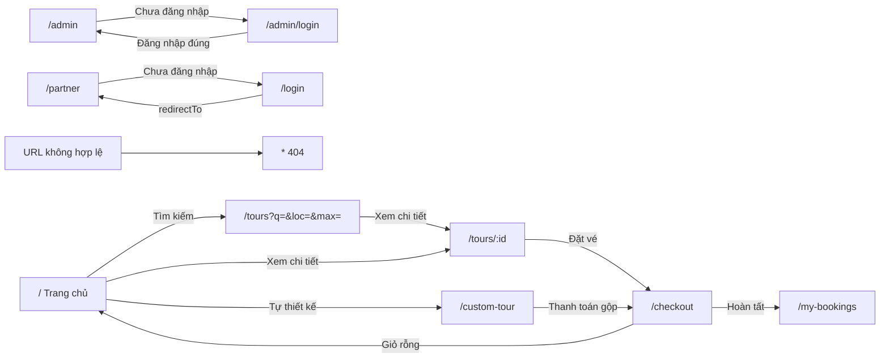

# ROUTES — Quản lý Tour Quảng Trị

## Bảng tuyến

| Đường dẫn | Màn hình | Ai vào | Dữ liệu | Trạng thái cần xử lý | Đi tiếp |
|---|---|---|---|---|---|
| `/` | `HomePage` | Mọi người | Banner, điểm đến, tour theo tab, bản đồ, đánh giá | đang tải | `/tours?…` (ô tìm kiếm), `/tours/:id`, `/custom-tour` |
| `/tours` | `ToursPage` | Mọi người | Danh sách tour + bộ lọc trên URL `?q=&loc=&max=` | đang tải, có dữ liệu, **rỗng khi lọc** ("Không tìm thấy tour phù hợp") | `/tours/:id`, `/custom-tour` |
| `/tours/:id` | `TourDetailPage` | Mọi người | Một tour theo `id` (ép `Number`) | có dữ liệu, không tìm thấy | `/checkout` |
| `/custom-tour` | `CustomTourBuilderPage` | Mọi người | Điểm di tích, HDV, xe | rỗng (chưa có điểm trong lịch trình) | `/checkout` |
| `/checkout` | `CheckoutPage` | Mọi người | State giỏ hàng (Tour, HDV, Xe) | thiếu state thì về `/` | `/my-bookings` |
| `/my-bookings` | `MyBookingsPage` | Mọi người (đăng nhập thì lọc theo tài khoản) | Đơn đã đặt (localStorage) | đang tải, rỗng | `/tours`, `/custom-tour` |
| `/about` | `AboutPage` | Mọi người | Tĩnh | — | `/tours` |
| `/contact` | `ContactPage` | Mọi người | Tĩnh | — | — |
| `/login` | `LoginPage` | Mọi người | — | sai tài khoản/mật khẩu; hỗ trợ `?redirectTo=` | trang theo vai trò |
| `/register` | `RegisterPage` | Mọi người | — | lỗi kiểm chứng Zod | `/login` |
| `/partner` | `PartnerDashboard` | Đã đăng nhập (PARTNER, GUIDE, DRIVER) | Chuyến sinh từ đơn đã duyệt + chuyến mẫu | chưa đăng nhập thì sang `/login`; sai quyền về `/` | — |
| `/admin` | `AdminDashboard` | Đã đăng nhập (ADMIN) | Thống kê từ đơn thật, tour, đơn đặt | chưa đăng nhập thì sang `/admin/login`; sai quyền về `/` | — |
| `/admin/login` | `AdminLoginPage` | Mọi người | — | sai tài khoản/mật khẩu | `/admin` |
| `*` | `NotFoundPage` | Mọi người | — | — | `/` |

> Các trang (trừ `/` và `*`) được tải theo yêu cầu bằng thuộc tính `lazy` của React Router để tách gói JS.

## Sơ đồ luồng (Mermaid)

## Kiểm thử tự động

Các luồng chuyển hướng ở trên được kiểm tra trong `src/app/routes.smoke.test.tsx` (`npm test`).
